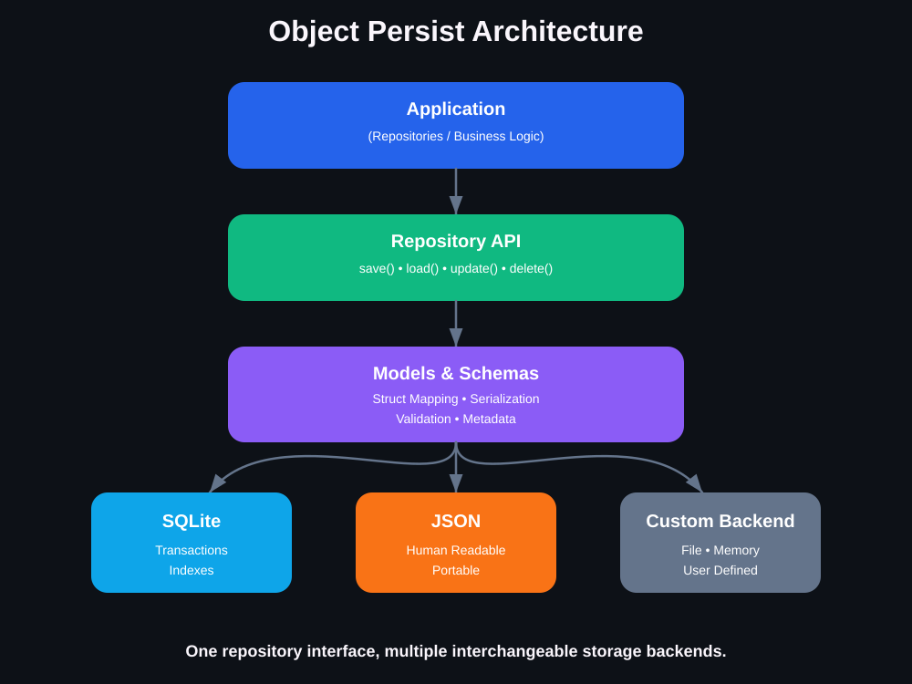

# Persistence Overview

The persistence module provides backend-agnostic storage infrastructure.

---

# Features

- Key-value persistence
- Object-model persistence
- Repository APIs
- Schema metadata
- Multiple storage backends

---

# Persistence Layers

```txt
Repository
   ↓
Model API
   ↓
Backend
   ↓
Storage
```

---

# Supported Backends

Current and planned backends include:
- file storage (key-value only)
- JSON
- SQLite (on by default; `-DBB_WITH_SQLITE=OFF` builds without it, see below)
- PostgreSQL (optional, build with `-DBB_WITH_POSTGRES=ON`; see [PostgreSQL Backend](postgres.md))

---

# Building Without SQLite

SQLite is a build-time option like PostgreSQL, but on by default:

```bash
cmake .. -DBB_WITH_SQLITE=OFF
```

| Build                          | Behavior                                                                                                                       |
|--------------------------------|--------------------------------------------------------------------------------------------------------------------------------|
| `BB_WITH_SQLITE=ON` (default)  | SQLite3 is located via `find_package(SQLite3 REQUIRED)`. The `"sqlite"` key/value and model backends are available.            |
| `BB_WITH_SQLITE=OFF`           | No SQLite dependency. `bb_persist_kv_sqlite_register()` and `bb_model_sqlite_api()` are not available, and `bb-migrate` cannot open SQLite files. |

When the option is on, `BB_WITH_SQLITE` is also defined for code that links the persist module, so applications that support several backends can guard the calls with `#ifdef BB_WITH_SQLITE` (the `todo` and `schema_api` examples do this and fall back to a JSON file). The `chat` example only supports SQLite and is skipped without it.

---

# Key-Value Persistence

The key-value system provides simple storage APIs for:
- configuration
- metadata
- lightweight persistence

---

# Object Persistence



The object-model persistence system uses schemas to persist structured entities.

This enables:
- reusable repositories
- backend-independent models
- structured serialization

---

# Querying

Repositories support `WHERE`/`ORDER BY`/`LIMIT`/`OFFSET` search via
`bb_repo_find()` — pushed down to SQL on backends that support it, and
falling back to an in-memory filter on backends that don't. See
[Querying](query.md).

---

# Schema Codegen

Schemas can be generated from a JSON manifest instead of hand-written,
removing manual `offsetof()` bookkeeping. See
[bb-codegen](../tools/codegen.md).